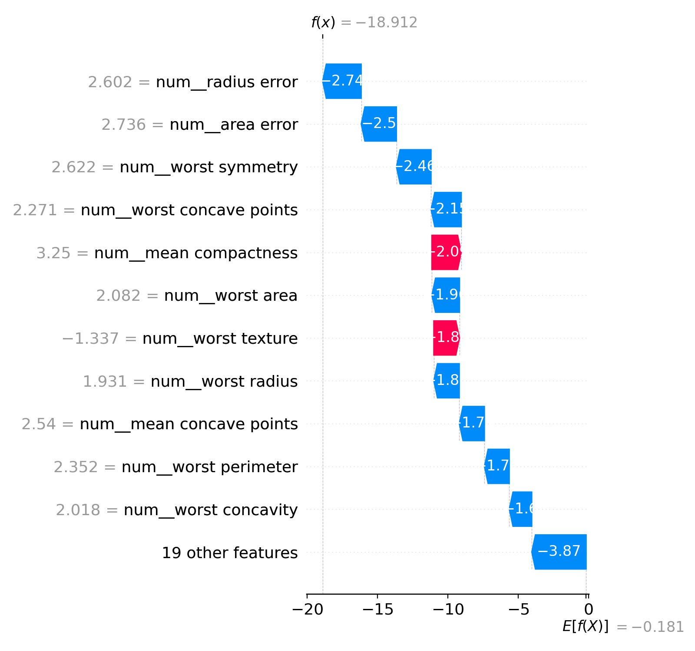

# Comparative Explainable AI Dashboard for Medical Predictions

An interactive Streamlit dashboard that compares how two popular explainable AI methods, **SHAP** and **LIME**, explain the same heart-disease predictions, and measures how often they agree.

BSc Computer Science dissertation, Brunel University London (2026), First Class Honours.



## Why this matters

In healthcare, an AI prediction is only useful if clinicians can understand why it was made. Different explanation methods can give different reasons for the same prediction, so this project makes that disagreement visible and measurable.

## Features

- **Prediction pipeline:** preprocessing (one-hot encoding, scaling, imputation) and a logistic regression model, built in scikit-learn
- **SHAP and LIME explanations** for any individual patient
- **Explanation Consensus Score (ECS):** Jaccard similarity between SHAP's and LIME's top-K features, from 0 (no overlap) to 1 (full agreement)
- **Counterfactual explanations** with DiCE, showing what would need to change to flip a prediction
- **Two dashboard views:** patient-level (one patient, all explanations side by side) and dataset-level (agreement across every record)
- **Adjustable Top-K slider** to test how the choice of K affects agreement

## Results

| Metric | Value |
| --- | --- |
| Test accuracy (stratified 20% hold-out) | 81% |
| Weighted F1 | 0.81 |
| Patient records analysed | 1,025 |
| Mean ECS (Top-K = 5) | 0.67 |
| ECS range | 0.25 – 1.00 |

Key findings:
- SHAP and LIME agree only partly: agreement varies widely across patients rather than clustering at full agreement.
- Measured agreement depends strongly on the choice of Top-K, so any comparison of explanation methods should justify its threshold.
- Over 20 repeated LIME runs per sampled patient, ECS stayed stable, so the disagreement is not just random noise from LIME's sampling.

High agreement shows two methods are consistent with each other. It does not prove that the explanation is correct or clinically valid.

## Tech stack

Python · scikit-learn · pandas · NumPy · SHAP · LIME · DiCE · Streamlit · Matplotlib · joblib

## Project structure

```
xai-medical-dashboard/
├── app/
│   ├── dashboard.py              # Patient-level dashboard (entry point)
│   └── pages/analysis.py         # Dataset-level ECS analysis
├── src/
│   ├── data_loader.py            # Loads and splits the dataset
│   ├── train_baseline.py         # Trains the preprocessing + model pipeline
│   ├── explain_shap.py           # SHAP explanations
│   ├── explain_lime.py           # LIME explanations
│   ├── explain_counterfactual.py # DiCE counterfactuals
│   ├── compare_shap_lime_ecs.py  # Normalises features and compares top-K sets
│   ├── ecs.py                    # Explanation Consensus Score
│   └── ecs_stats_extended.py     # Dataset-wide ECS statistics
├── data/heart.csv                # Public heart disease dataset (1,025 records)
├── models/baseline_pipeline.joblib
└── reports/                      # Example outputs
```

## How to run

```bash
git clone https://github.com/sepehrnasrati/explainable-ai-dashboard.git
cd explainable-ai-dashboard/xai-medical-dashboard
pip install -r requirements.txt
streamlit run app/dashboard.py
```

A trained model is included. To retrain it, run `python src/train_baseline.py`.

## Limitations and future work

- Logistic regression was used as an interpretable baseline. Future work would compare agreement across more complex models such as random forests and gradient boosting.
- Repeated-run stability testing could be extended to more patients.
- The dataset is public and anonymised. The system is a research prototype and has not been clinically validated.

## Author

**Sepehr Nasrati** · [LinkedIn](https://www.linkedin.com/in/sepehr-nasrati) · [GitHub](https://github.com/sepehrnasrati)
